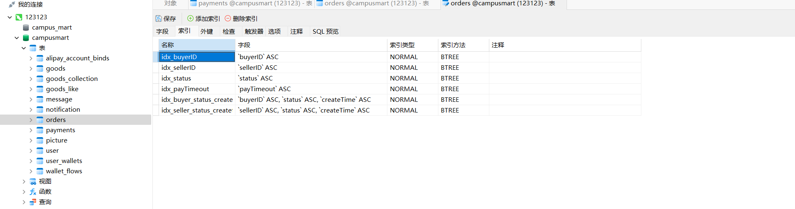
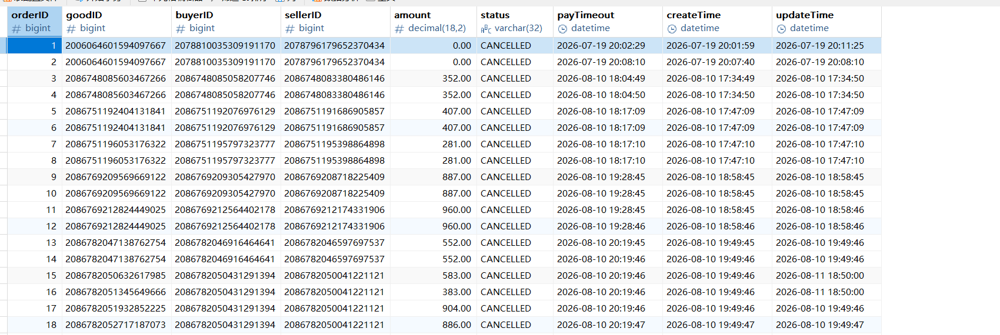
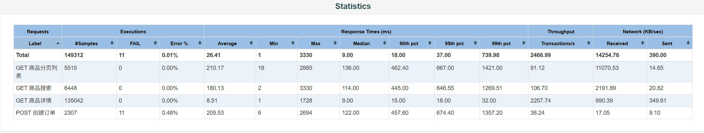
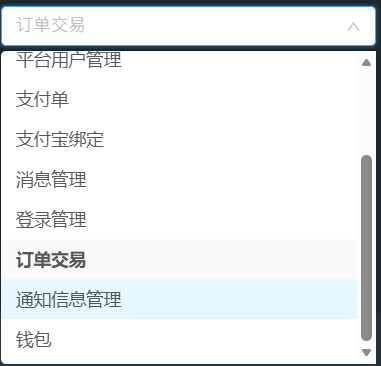
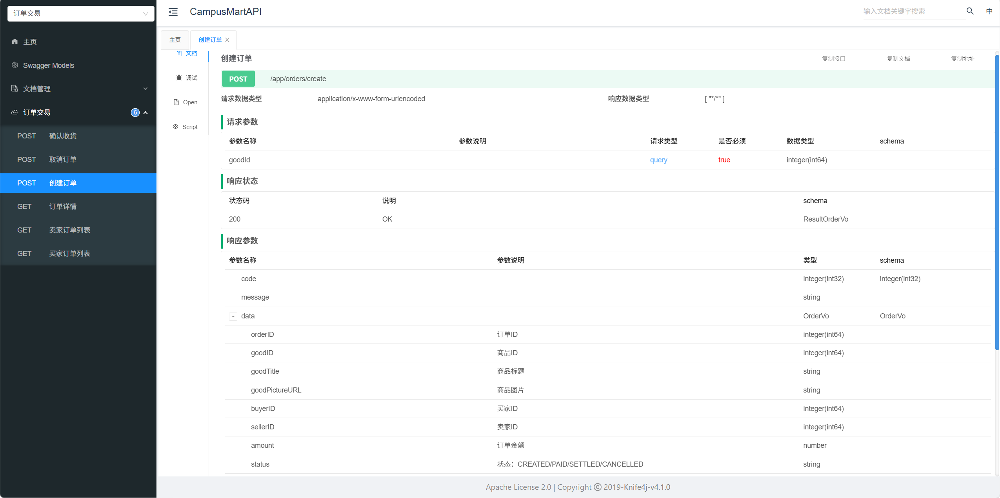

# CampusMart 后端服务

> 面向校园场景的二手闲置物品交易平台后端，采用 Spring Boot 单体架构实现，为前端 App 提供 RESTful API 接口。
> 后端聚焦商品发布、订单交易、支付结算、钱包流水、消息沟通等核心业务，并通过 JWT 认证、Redis 多级缓存、RabbitMQ 延时队列、Redisson 分布式锁等机制保障并发安全与状态一致性。

---

## 一、项目简介

CampusMart 是一款校园二手闲置物品交易平台的后端服务，基于 Spring Boot+ Java 构建，采用单体模块化结构。项目覆盖用户、商品、订单、支付、钱包、消息六大核心业务模块，为前端提供完整的交易能力支撑。

### 核心目标

- **完整交易链路**：从用户注册、商品发布、下单、支付到确认收货、钱包结算，覆盖二手交易全生命周期。
- **并发安全**：通过 Redis 缓存策略、Redisson 分布式锁、MyBatis-Plus 乐观锁等机制应对热点数据与高并发场景。
- **状态最终一致**：订单超时取消、支付单状态流转等关键链路采用状态机 + 异步补偿 + 定时兜底的多重保障。
- **可观测与可测试**：Druid 慢 SQL 监控、Knife4j 在线接口文档，并配套独立的接口自动化测试工程。

---

## 二、技术栈

| 分类       | 技术                                     | 用途           |
| :------- | :------------------------------------- | :----------- |
| **核心框架** | Spring Boot 3.0.5 / Java 17            | 后端主框架        |
| **数据访问** | MyBatis-Plus 3.5.3.1 / Druid 1.2.23    | ORM 与连接池监控   |
| **缓存**   | Redis / Redisson 3.23.5 / Spring Cache | 分布式缓存与锁      |
| **消息队列** | RabbitMQ                               | 延时队列、异步解耦    |
| **存储**   | MySQL 8.x / 阿里云 OSS                    | 业务数据与文件存储    |
| **安全**   | JWT / MP 乐观锁                           | 认证与并发安全      |
| **工具**   | Maven / Lombok / Hutool / Knife4j      | 构建、代码简化、接口文档 |
| **性能测试** | JMeter 5.6.3 | 多场景并发压测 |

---

## 三、系统架构

采用经典分层架构：

- **Controller**：接收前端 HTTP 请求，按模块划分为 goods、trade、payment、wallet、message 等。
- **Service**：处理业务逻辑，包括订单状态机、支付回调幂等、钱包乐观锁更新等。
- **Mapper**：基于 MyBatis-Plus 访问 MySQL。
- **中间件**：Redis 提供缓存与分布式锁；RabbitMQ 提供延时消息与异步解耦；OSS 提供图片存储。

---

## 四、数据库设计

核心实体包括 user、goods、orders、payments、user_wallets、wallet_flows、message、notification、picture 等。下面是 `orders` 表的索引设计与实际数据示例。

### 4.1 orders 表索引



### 4.2 orders 表数据示例



---

## 五、项目结构

```text
CampusMart/
├── server/                              # 后端服务根目录
│   ├── model/                           # 数据层：Entity、VO、Enums
│   │   └── src/main/java/org/example/CampusMart/model/
│   │       ├── entity/                  # 数据库实体（User、Goods、Order、Payment 等）
│   │       └── enums/                   # 业务枚举（基础枚举接口等）
│   │
│   ├── common/                          # 公共模块
│   │   └── src/main/java/org/example/CampusMart/common/
│   │       ├── exception/               # 全局异常体系（自定义异常、全局异常处理）
│   │       ├── result/                  # 统一响应封装（Result、ResultCodeEnum）
│   │       ├── login/                   # 登录用户信息上下文（LoginUser、LoginUserHolder）
│   │       ├── oss/                     # 阿里云 OSS 配置与属性
│   │       ├── mybatisplus/             # MyBatis-Plus 配置（乐观锁等）
│   │       └── utils/                   # 工具类（JWT、验证码等）
│   │
│   └── base-service/                    # 核心业务服务
│       ├── src/main/java/org/example/CampusMart/
│       │   ├── WebApplication.java      # Spring Boot 启动类
│       │   └── web/
│       │       ├── config/              # 基础配置（Redis、RabbitMQ、Druid、Alipay 等）
│       │       ├── custom/
│       │       │   ├── config/          # 自定义配置（WebMvc、Knife4j 等）
│       │       │   ├── converter/       # 类型转换器（StringToEnumConverterFactory）
│       │       │   └── interceptor/     # JWT 登录认证拦截器
│       │       ├── controller/          # API 接口层（按模块划分：goods、trade、payment 等）
│       │       ├── service/             # 业务逻辑层（接口 + impl 实现）
│       │       ├── mapper/              # 数据访问层（MyBatis-Plus Mapper）
│       │       ├── vo/                  # 视图对象（请求/响应 VO）
│       │       ├── listener/            # RabbitMQ 消费者（订单超时监听）
│       │       └── job/                 # 定时任务（订单超时扫描、支付超时关闭）
│       └── src/main/resources/
│           ├── mapper/                  # MyBatis XML 映射文件
│           └── application.yml          # 主配置文件
│
├── database generater/                  # 数据库初始化脚本
│   ├── campusmart-build-database.sql    # 初始建表脚本
│   ├── campusmart-upgrade-monolithic.sql
│   └── campusmart-upgrade-poc.sql
├── .gitignore
└── README.md
```

---

## 六、核心功能与链路

| 模块 | 核心能力 | 技术要点 |
|------|----------|----------|
| **用户模块** | 注册、登录、JWT 认证、个人信息管理 | ThreadLocal 存登录态、统一响应封装 |
| **商品模块** | 商品发布、编辑、删除、列表查询、模糊搜索、图片上传、收藏与点赞 | Redis 旁路缓存、OSS 文件存储|
| **订单模块** | 下单、订单状态流转、超时自动取消、买家/卖家订单列表 | RabbitMQ 死信队列 + 定时任务兜底 |
| **支付模块** | 支付单创建、状态同步、待支付订单关闭 | 状态机 + 幂等校验 |
| **钱包模块** | 余额查询、充值、消费流水、提现 | MyBatis-Plus 乐观锁防并发 |
| **消息模块** | 买卖双方消息沟通、最近会话列表、系统通知 | 前端轮询、会话聚合 |

---

## 七、项目亮点

### 7.1 JWT + ThreadLocal 无状态认证

统一登录认证拦截器解析请求头中的 JWT Token，将用户信息写入 `ThreadLocal`，业务层通过 `LoginUserHolder` 随时获取当前登录用户，避免每次从 Token 中重复解析。


### 7.2 Redis 多级缓存策略

- **Cache Aside 旁路缓存**：读时先查缓存，未命中再查数据库并回写；写时先更新数据库，再删除缓存。
- **空值缓存**：防止缓存穿透，对不存在的数据也缓存短暂时间。
- **随机 TTL**：为不同缓存空间设置差异化过期时间，避免缓存雪崩。
- **Redisson 分布式锁**：访问热点数据前加锁，防止缓存击穿。

```java
RLock lock = redissonClient.getLock("goods:lock:" + goodId);
try {
    if (lock.tryLock(3, 10, TimeUnit.SECONDS)) {
        // 双重检查缓存
        GoodsDetailVo vo = redisTemplate.opsForValue().get(key);
        if (vo != null) return vo;
        vo = goodsService.getDetailFromDb(goodId);
        redisTemplate.opsForValue().set(key, vo, ttl, TimeUnit.MINUTES);
        return vo;
    }
} finally {
    lock.unlock();
}
```

### 7.3 订单超时自动取消

- **主流程**：用户下单后发送一条 30 分钟 TTL 的延迟消息到 RabbitMQ 死信队列；超时后消费者检查订单状态，若为 `CREATED` 则取消订单并关闭支付单。
- **兜底补偿**：每 5 分钟执行一次 `@Scheduled` 任务，扫描超过 35 分钟仍未取消的 `CREATED` 订单，避免消息消费异常导致的状态不一致。

```java
@RabbitListener(queues = ORDER_TIMEOUT_QUEUE)
public void handleOrderTimeout(OrderTimeoutMessage message) {
    try {
        Order order = orderService.getById(message.getOrderId());
        if (order == null || !OrderStatus.CREATED.equals(order.getStatus())) {
            return;
        }
        orderService.cancelOrder(order);
        paymentService.closePendingPaymentByOrderId(order.getId());
    } catch (Exception e) {
        log.error("订单超时处理异常", e);
    }
}
```

### 7.4 支付单状态机


支付单定义 `CREATED / PAYING / PAID / CLOSED` 四种状态，状态流转严格受限：

| 当前状态 | 允许流转 | 说明 |
|----------|----------|------|
| CREATED | PAYING / CLOSED | 用户发起支付或订单超时 |
| PAYING | PAID / CLOSED | 支付回调成功或主动关闭 |
| PAID | - | 终态 |
| CLOSED | - | 终态 |

支付宝回调处理时先校验订单状态必须为 `CREATED`，并对接口进行幂等校验，防止重复通知导致重复更新。

```java
Order order = orderService.getById(payment.getOrderId());
if (!OrderStatus.CREATED.equals(order.getStatus())) {
    log.warn("订单状态非 CREATED，忽略回调");
    return;
}
// 更新支付单与订单状态为 PAID
```

### 7.5 SQL 性能优化

- **Druid 慢 SQL 监控**：连接池开启 `stat` 过滤器，慢 SQL 阈值设为 1000ms，便于线上问题定位。
- **核心索引**（分布在建表脚本与升级脚本中）：
  - `orders` 表：
    - 单字段索引：`idx_buyerID`、`idx_sellerID`、`idx_status`、`idx_payTimeout`
    - 联合索引：`idx_buyer_status_createtime` 、`idx_seller_status_createtime` 
  - `payments` 表：
    - 唯一索引：`uk_orderID`（防止一个订单对应多个支付单）
    - 普通索引：`idx_userID`、`idx_status_expireTime`、`idx_orderid_status` 
- **N+1 优化**：订单/商品列表查询使用单条 JOIN + 子查询获取最新商品图片，避免循环查图片表。

### 7.6 MyBatis-Plus 乐观锁

`UserWallet` 实体使用 `@Version` 字段实现乐观锁，`MybatisPlusConfiguration` 注入 `OptimisticLockerInnerInterceptor`；钱包余额更新通过 `updateById` 自动携带版本号，冲突时直接抛异常，由上层决定重试策略。  

### 7.7 缓存性能验证（JMeter 压测）

针对 Redis 缓存策略进行 JMeter 多场景压测验证：

- **压测对象**：商品详情（走缓存）/ 商品分页 / 商品搜索（无缓存）/ 创建订单（写）
- **场景设计**：20 / 50 / 100 并发多场景，含 73%浏览+15%详情+10%搜索+2%下单 的混合场景模拟真实用户
- **核心结果**（20并发轮）：

| 接口 | 是否缓存 | P50 | TPS |
|------|:---:|---:|---:|
| 商品详情 | ✅ Redis缓存 | 9ms | 2258/s |
| 商品分页 | ❌ 无缓存 | 136ms | 91/s |
| 商品搜索 | ❌ 无缓存 | 114ms | 107/s |

缓存接口吞吐约为无缓存接口的 20~25 倍，验证了旁路缓存 + 空值缓存 + 随机TTL 策略在高频读场景下的有效性。



---


## 八、快速开始

### 8.1 环境要求

- JDK 17+
- Maven 3.8+
- MySQL 8.0+
- Redis 7.0+
- RabbitMQ 3.11+

### 8.2 克隆与构建

```bash
git clone https://github.com/Ke1logG/CampusMart2.0.git
cd CampusMart2.0/server/base-service
mvn clean package -DskipTests
```

### 8.3 初始化数据库

```bash
mysql -u root -p < "database generater/campusmart-build-database.sql"
```

### 8.4 修改配置

在 `server/base-service/src/main/resources/` 下创建或修改 `application-dev.yml`，按需配置：

- MySQL 连接地址、用户名、密码
- Redis 地址、密码
- RabbitMQ 地址、用户名、密码
- 阿里云 OSS 

主配置 `application.yml` 已使用环境变量 + 默认值的方式管理通用连接信息，可直接覆盖环境变量或在 `application-dev.yml` 中声明。

### 8.5 启动服务

```bash
mvn spring-boot:run
# 或
java -jar target/base-service-1.0-SNAPSHOT.jar
```

---

## 九、接口文档

本地启动服务后，通过 Knife4j 查看在线文档：

地址：http://localhost:8080/doc.html

包含：请求参数、响应示例、认证说明。

### 9.1 接口分组



### 9.2 接口详情示例（创建订单）



---

## 十、接口自动化测试

本项目配套独立的接口自动化测试工程：[API-Automation-Testing-Platform](https://github.com/Ke1logG/API-Automation-Testing-Platform)

该测试工程覆盖注册登录、商品发布、订单创建、支付回调、确认收货、钱包结算等核心链路，基于 JUnit 5 + REST Assured + Allure 构建。

### 运行方式

1. 启动后端 CampusMart 服务
2. 配置自动化测试项目的 `application-local.properties`
3. 执行测试：

```bash
mvn clean test
```

4. 查看 Allure 报告：

```bash
mvn allure:serve
```  
  
该测试工程同时包含 JMeter 性能测试报告，测试覆盖商品详情、分页、搜索、下单四接口的 20/50/100 并发压测场景。
